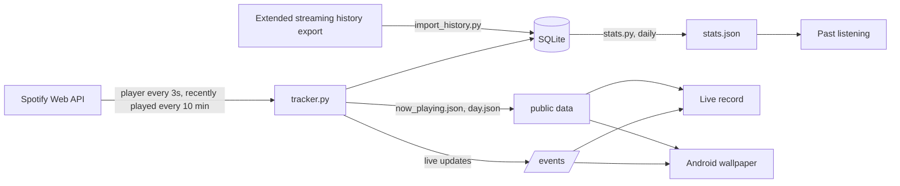

# Wall of Tracks

Artworks made from the album covers of what I listen to on Spotify.

- **Live record** — https://walloftrack.thomasjuldo.com: the last 24 hours of listening as a slowly
  turning picture disc. One slice per album, sized by how long it played and ordered around the colour
  wheel; the label and the blurred background follow the song that's playing, and the record only
  spins while music plays. Double click to switch between the organic (wavy, flowing) and the classic
  record.
- **Past listening** — https://walloftrack.thomasjuldo.com/past/: the whole listening history since 2014
  as Eras, Groove and Records, and the top 10 (all time or per year) as Spiral and Sleeve.
- **Android live wallpaper** — the live record on the phone's home and lock screens.

## How it fits together



Everything runs on a small server: the tracker polls Spotify, keeps the history in SQLite and publishes
JSON for the pages, which draw everything themselves in the browser (or on the phone).

| Path | What it is |
| --- | --- |
| `tracker/tracker.py` | The tracker: polls the player, records plays, publishes `now_playing.json` and `day.json`, pushes live updates |
| `tracker/live.py` | The live update stream (Server-Sent Events) the tracker serves on `127.0.0.1:8790/events` |
| `tracker/auth.py` | One-time Spotify login that stores the refresh token |
| `tracker/import_history.py`, `tracker/enrich.py` | Import a Spotify history export, then fetch covers and ids for its tracks |
| `tracker/stats.py` | Builds `stats.json` for the past-listening page |
| `tracker/web/` | The live record (`index.html`) and the past-listening page (`past/`) |
| `tracker/*.service`, `*.timer`, `nginx-walloftrack.conf` | systemd units and the nginx site |
| `android/` | The live wallpaper app |
| `app.py`, `art_from_files.py`, `templates/` | The original Flask app (Spotify login, a wall of recent tracks, mosaics of top albums) |

### Why plays are recorded twice

Spotify's *recently played* list is the reference, but it can lag by ten minutes or more and only lists
plays of 30 seconds or longer. So the tracker also watches the player and records a play the moment a
track ends (`source = 'observed'`). When Spotify's row for that listen arrives — dated anywhere from
just before the end to a while after, when Spotify only logs it as the session closes — the two are
merged, and Spotify's row keeps the listening time the tracker measured.

## Running the tracker

It needs Python 3.12 and a [Spotify app](https://developer.spotify.com/dashboard) whose redirect URIs
include `http://127.0.0.1:27150/walloftrack/spotify/callback/`.

```bash
cd tracker
python3 -m venv .venv
.venv/bin/pip install -r requirements.txt
```

The app's credentials come from `SPOTIPY_CLIENT_ID` / `SPOTIPY_CLIENT_SECRET`, or else from `conf.json`
at the repository root (`{"spotify": {"id": "...", "secret": "..."}}`, not committed).

Log in once. On a headless server, forward the callback port from your own machine first
(`ssh -L 27150:127.0.0.1:27150 <server>`), run this there and open the printed URL locally:

```bash
.venv/bin/python auth.py
```

Then install the services (the unit files assume the repository lives in `/home/ubuntu/Projects/`):

```bash
sudo cp wall-of-tracks-tracker.service wall-of-tracks-stats.service wall-of-tracks-stats.timer /etc/systemd/system/
sudo systemctl daemon-reload
sudo systemctl enable --now wall-of-tracks-tracker wall-of-tracks-stats.timer
```

The pages are static files: copy `tracker/web/` into the web root, which the tracker also writes its
JSON into (`/var/www/walloftrack/data` in the unit file). `nginx-walloftrack.conf` serves that folder
and proxies `/events` to the tracker; `certbot --nginx` adds HTTPS.

```bash
rsync -a web/ /var/www/walloftrack/
```

Settings, all optional:

| Variable | Default | |
| --- | --- | --- |
| `WOT_DATA_DIR` | `tracker/data` | Database, token, cover colours |
| `WOT_PUBLIC_DIR` | `$WOT_DATA_DIR/public` | Where the public JSON goes |
| `WOT_ACTIVE_INTERVAL` | `3` | Seconds between player checks while listening (and 10 min after) |
| `WOT_IDLE_INTERVAL` | `10` | Seconds between player checks otherwise |
| `WOT_RECENT_INTERVAL` | `600` | Seconds between *recently played* syncs |
| `WOT_LIVE_PORT` | `8790` | Port of the live update stream |
| `SPOTIPY_REDIRECT_URI` | the callback above | Only if your Spotify app uses another one |

### Importing the full history

Request the *Extended streaming history* from Spotify's privacy settings. Once it arrives:

```bash
.venv/bin/python import_history.py path/to/Spotify\ Extended\ Streaming\ History/
.venv/bin/python enrich.py
```

Both are safe to re-run with a newer export: plays already there are kept once, and the export's rows
replace the matching live ones. `stats.py` picks the new history up on its next run (daily at 04:00 UTC).

## The Android wallpaper

Android 13 or newer (the flow effect is an AGSL shader). It reads the same public data and live
stream as the web page, only while the wallpaper is visible, and stops drawing when nothing moves.

```bash
cd android
./gradlew assembleDebug
adb install -r app/build/outputs/apk/debug/app-debug.apk
```

Then open *Wall of Tracks* from the app drawer to preview and set it. A double tap on an empty part of
the home screen switches between the organic and the classic record. Building needs the Android SDK
(platform 34); point `android/local.properties` at it with `sdk.dir=...`.
